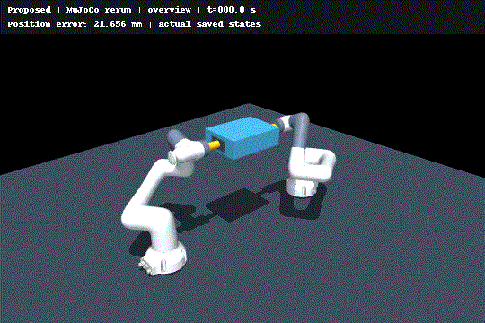
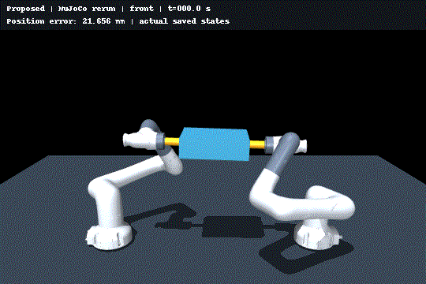

# Dual-CR7 MuJoCo reproduction

论文对应的双 CR7 协作搬运仿真代码。The **Proposed** controller retains the paper's sign feedback and full composite-learning law. This repository contains the models, fixed protocol, tests, independent validation, and figure scripts. The private manuscript and large generated trajectories are not included.

## Newly rerun demonstration

The GIFs below are **two cameras viewing the same newly simulated 24 s nominal Proposed trial**, not two independent experiments. They display recorded MuJoCo states at 10 fps, real time. No trajectory is generated by the renderer. Numerical verification and source hashes accompany the animations; animation alone does not establish convergence.





See [animation provenance](media/provenance.json) and [verification](verification/README.md).

## Install

Tested on Linux with Python 3.10 and MuJoCo 3.12.0. No ROS installation is needed.

```bash
python3 -m venv .venv
source .venv/bin/activate
python -m pip install --upgrade pip
python -m pip install -r simulation/requirements.txt
```

For the recorded Python 3.10 numerical stack, install `requirements-reproduction.txt` instead. The regular requirements permit newer library versions.

Headless rendering uses EGL (`MUJOCO_GL=egl`); a working Mesa/NVIDIA EGL runtime is needed. CPU simulations and tests do not need a display. On Ubuntu, headless packages may include `libegl1`, `libgl1`, and `libgl1-mesa-dri`.

## Test and reproduce the animated trial

Run all commands from the repository root:

```bash
python -m pytest simulation/tests -q -p no:cacheprovider
python simulation/run_comparison.py --protocol reference/protocol.json \
  --trial nominal__proposed --output simulation/results_demo
python simulation/validate_comparison.py --results simulation/results_demo \
  --protocol reference/protocol.json --trial nominal__proposed
MUJOCO_GL=egl python tools/render_gifs.py
```

The trial records the actual plant trajectory, applied commands, filters, parameter estimates, and source manifest. Completed results are protected against accidental overwriting. To repeat a trial, choose a new output directory and pass its trajectory to `render_gifs.py --input ...`.

## Full 44-trial comparison

Use the bundled protocol to preserve the paper's exact fixed settings, including the external PPC configuration:

```bash
mkdir -p simulation/results_comparison
cp reference/protocol.json simulation/results_comparison/protocol.json
python simulation/run_comparison_all.py --output simulation/results_comparison --resume --workers 2
python simulation/validate_comparison.py --results simulation/results_comparison
python simulation/make_comparison_report.py --results simulation/results_comparison
python simulation/plot_comparison.py --results simulation/results_comparison
```

Allow several GB of free disk space (the original full data were about 8 GB). Start with two workers; more workers increase memory/CPU demand. Main trials last 24 s; initial-state scans 8 s; two additional trials halve both timesteps. A full study can take substantially longer than a single demonstration.

To generate a new equivalent protocol instead of copying the recorded one, explicitly pass `--external-config simulation/configs/comparison_external_ppc.json` to `run_comparison_all.py`. Omitting it uses different external-controller defaults and is **not** the registered comparison.

## Paper figures

After the full run, validation, and report commands above:

```bash
python simulation/prepare_manuscript_results.py
python simulation/prepare_manuscript_sweep.py
MUJOCO_GL=egl python simulation/prepare_manuscript_scene.py \
  --input simulation/results_comparison/main/nominal/proposed/trajectory.npz
```

Figures 2–5 use the PGF/pdfLaTeX backend with Times text and LaTeX math, retaining recorded samples. Install TeX Live (LaTeX base/recommended packages, PGF, Times fonts) and Poppler (`pdflatex` and `/usr/bin/pdftoppm`). Large vector figures require extra TeX memory, configured per subprocess by the plotting script. Figures appear in `manuscript_figures/` (gitignored).

## Scientific scope

- Full original control and learning are in `simulation/jas/` and `simulation/comparison/`; constant settings are recorded before the trials.
- True parameters and reaction forces are plant/offline diagnostic information, not online controller measurements.
- Finite-compliance welds approximate ideal rigid grasps. Sampled sign feedback produces timestep-sensitive ripple.
- IE with nonzero stored residuals does not imply exact identification. The study reports nonzero parameter errors and does not claim numerical proof of exact sliding or a global fixed-time theorem.
- External PPC native funnels differ from the common assessment bounds. Keep both metrics and every trial outcome.
- Historical identification-extension modules are included for helper imports/tests; do not use them as the paper's Proposed method.

See [protocol details](REPRODUCIBILITY.md), [third-party notices](THIRD_PARTY.md), and [recorded environment](reference/environment.json). `reference/comparison_metrics.json` contains historical reference metrics, not validation of a fresh run. The export changes only the comparison manifest's dependency on the private manuscript to `REPRODUCIBILITY.md`; controller/plant code is preserved.
